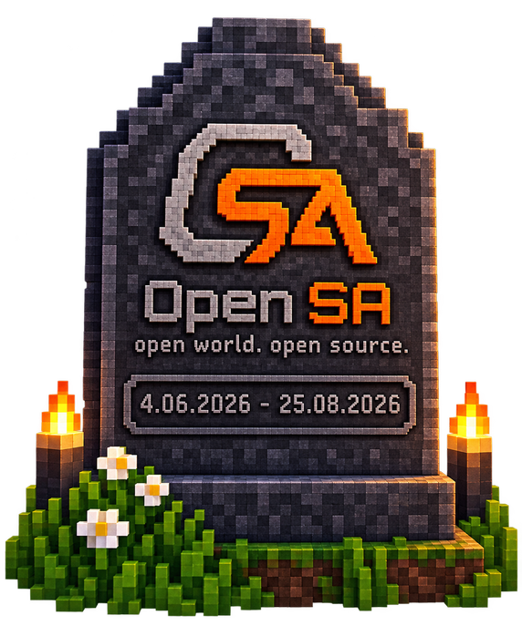

# OpenSA is closed. The rise of AI, and thoughts on how to survive in the age of AI

Hi everyone! This is the closing article of the OpenSA saga. For context: OpenSA is my AAA game engine for the browser, written from scratch in TypeScript, that can work through adapters with the files of the old RenderWare engine that GTA San Andreas was built on. That is how I managed to run the GTA San Andreas map in the browser, which I described in the previous articles.

> OpenSA is an unofficial, non-commercial fan project, not affiliated with Rockstar Games or Take-Two Interactive. It never contained or distributed any game assets: the engine read the files from the user's own legitimate copy or from community mods. GTA San Andreas, its assets and trademarks belong to Rockstar Games / Take-Two.

The project was made purely for fun, without the original's code and without its assets (the formats were read, the logic was not ported), to study AI (Claude Code, specifically) — and back then I had no real idea how far I could get with modern AI tools, or what would come out of it. Over the project's lifetime, from 4 June 2026 to 25 August 2026, with Claude and my engineering approach I did what used to be impossible for me: I built a genuinely working engine prototype with basic graphics, a streaming system, 3D and the rest. Those are the things I want to talk about in this article — the fate of the project, the rise of AI, and our future as programmers in the age of AI.

I was very surprised that my project started gaining popularity without any promotion, and when I closed it, for a month I got the same question almost every day through every channel there is (from Telegram to LinkedIn). I'll answer it now.

## What happened to the project?

The project was closed on 25 August 2026. The repository and the demo are offline.

Nobody from Rockstar or Take-Two ever contacted me; I received no threats and no strikes. There was one signal I decided to take into account, and I made the repository private — temporarily, as I thought at the time. Barely two weeks later Rockstar updated their Mod Guidelines (10 September 2026):

[Rockstar Games Mod Guidelines](https://www.rockstargames.com/community-resources/mod-guidelines)

They added this clause:

> Do not modify our games to operate on consoles, hardware devices, or other platforms where they have not been
> officially released by Rockstar Games.

As I read this clause, projects like mine may fall under it, and I don't want to argue with that. So, out of deep respect for their products and their work, I stopped working on the project.

If someone decides to continue my code in their own fork, I have nothing to do with it — think for yourself and use it at your own risk.

I apologise to the community members who wanted to see the project in its final form — unfortunately, that is not possible. Please be understanding.

## Why this is happening

Over the last couple of months we have been watching a real AI boom. Releases and re-releases of old (and not so old) games are happening literally every day. For example, right now, in October 2026, this very week I saw a full conversion of GTA Vice City to the Web — and, even better, GTA V was released for the Web! It's incredible and impressive. The site disappeared within a few hours.

A number of truly unusual projects came out — auto-compilers of console games such as GTA Vice City Stories, but for PC.

And it is not only about the GTA series.

A project was released that reimplements Red Alert 2 with the specifics of playing on modern mobile devices taken into account:

[RedAlert2-Mac-iOS-iPad](https://github.com/ammaarreshi/RedAlert2-Mac-iOS-iPad)

Or the recent drama around the fan project Fallout New York, where a person generated a world resembling the original with the help of AI. ZeniMax (Bethesda's parent company) sent the author a cease-and-desist letter, and the project was taken down ([Kotaku](https://kotaku.com/activision-and-bethesda-crackdown-on-genai-mw2-and-fallout-projects-2000739580)).

And it's not only games: open-source reimplementations of Adobe products have appeared, for example. More than once:

- [vectorcraft](https://github.com/storytold/vectorcraft) — a reimplementation of Adobe Illustrator
- [printcraft](https://github.com/storytold/printcraft) — a reimplementation of Adobe Acrobat
- [compositor](https://robbietilton.com/compositor) — a Photoshop-style editor

In short, the trend is clear.

So what are software and game developers supposed to do — the ones who spend millions of dollars and years of development — when a lone developer armed with Claude Code vibe-codes a project over a beer? Right, they go to extreme measures.

Honestly, as a developer myself, I understand and support them. I would also be very unhappy if someone reworked my work like that.

## Developing with AI

I started using AI at the end of April 2026, and before OpenSA my experience was finishing up a few of my own open-source libraries. My attitude towards Claude and AI has turned around completely.

A year ago I saw Cursor and strongly disliked it. I thought AI was essentially ChatGPT, or search on steroids.

What I understand now is that modern AI models are far stronger than a human, and with their help you get magic like this:

[universal-modder](https://github.com/rehan-remade/universal-modder)

Personally, I can't even put into words how this works. Just magic, that's all. Have a look at this video:

[Anyone Can Merge Games Now... This Changes EVERYTHING](https://www.youtube.com/watch?v=yGkjS0gFxnY)

With projects such as:

- [GameNative](https://github.com/utkarshdalal/GameNative)
- [Game-Decompilations](https://github.com/SamidyFR/Game-Decompilations)

the world of game modding, and of building new games, will never be the same.

More and more often I think about whether AI can replace a human. I used to say — of course not, what can it do. Now I lean towards the answer: yes. Maybe not everyone, but many.

And we should treat all of this differently. The transformation in the AI segment is happening so fast that we can't keep up with adapting.

Personally, I no longer even look at what the AI produces — I don't review the code. Claude writes very good code, and code has become very cheap. Reviewing it is a waste of time that is worth more; if it fails, it's easier to redo it.

We should treat AI in coding as a new level of abstraction. We used to work with bytecode, then high-level languages came, now AI. We are becoming architects, true Creators.

We can't compete with AI, but we can direct it. And the more imagination we have, the better the result. The projects I listed above prove this, and they are far from a complete list.

## What's next for me?

Even though OpenSA is closed, I haven't lost interest in building my own AAA engine. Quite the opposite: working on the project, I gained a huge amount of new knowledge in a very short time. Given my experience as an architect of Web systems, a DevOps, a backend and a frontend developer, I can mix it all and get very interesting results.

I plan to start over. OpenSA imposed a lot of limitations because of the old assets, approaches and formats of the original game. I want to design the architecture of a new engine so that it uses every modern aspect of computer graphics while being super fast and optimised to run even on ancient devices.

The Web platform, of course, isn't a great fit for engines of this kind; while working on OpenSA I ran into a mass of limitations. For example, 9 runs out of 10 could be glitch-free, and on the 10th, for no identifiable reason, stuttering could start. Other open tabs could slow down the main tab with the game. On the Web there is no way to track that. So I would make a Web version, but only a simplified, secondary one — the main engine should of course be cross-platform and adapted to different devices.

Right now the biggest problem is assets. I see two options here. Generating them with AI myself — that is still very hard, because AI doesn't let you develop a single consistent style across hundreds of models. Option two — find an indie studio that would agree to a collaboration.

For now I've set myself a goal: experiment until New Year and see what comes of it. If there is a result, I'll start from scratch. If not, I'll drop it.

Either way, I'll try to publish articles in this repository, to stay in touch with the community and to put my thoughts into words. Maybe later I'll create a Telegram or Discord channel.

Thank you all for your attention! Until next time!
